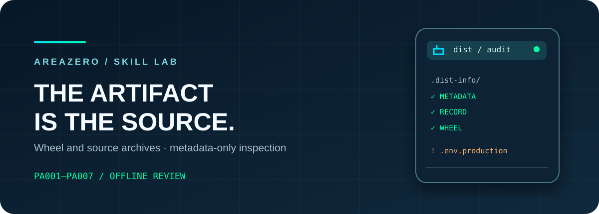
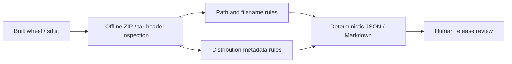

<p align="center"></p>
<p align="center"></p>

# Python Artifact Audit

**Inspect the *shipped archive*, not your working tree.** A deterministic, dependency-free Agent Skill that identifies risky member paths, filename-only credential indicators, duplicate payload paths and required Python distribution metadata — without extraction, execution, uploading artifacts or reading packaged file contents.

[](https://github.com/Kanompung1988/python-artifact-audit/actions/workflows/ci.yml) · [Agent Skills specification](https://agentskills.io/specification) · [Rules](references/RULES.md) · [Sources](references/SOURCES.md) · [MIT code license](LICENSE)

## Why an archive-first audit?

Source directories are not equivalent to binary wheels or source distributions: build backends choose their own file sets, with files accidentally included or omitted. Inspecting *the artifact bytes that CI intends to publish* can uncover a `.env.production`, `.git/config`, surprising symlink or malformed wheel metadata before the release is uploaded. This scanner only examines names and ZIP/tar headers; it cannot discover secrets hidden inside innocently named files.



## Get started in under a minute

```bash
git clone https://github.com/Kanompung1988/python-artifact-audit.git
cd python-artifact-audit
python scripts/audit.py examples/safe-1.0-py3-none-any.whl --format json --fail-on high
python scripts/audit.py examples/unsafe-1.0-py3-none-any.whl --format markdown --fail-on none
# Your project: audit built files, before pushing to PyPI
python scripts/audit.py dist/*.whl dist/*.tar.gz --format json --fail-on high
```

**Exit codes:** `0` means none of the supported rules meets your severity threshold, `2` means review findings, `1` means an invalid, symlinked, encrypted or oversized input. JSON includes exact archive/member names and rule identifiers to support reproducible CI checks. Avoid `--fail-on none` in a release gate; it intentionally always returns zero for parseable archives.

### Reproducible synthetic demonstration

The bundled `unsafe` wheel deliberately contains **dummy** `.env.production`, `.git/config`, and `__pycache__` members, not credentials. Output includes:

```text
HIGH   PA002 demo/.env.production     Sensitive-looking filename is bundled in distribution
MEDIUM PA003 demo/.git/config         Build cache / repository metadata bundled in distribution
MEDIUM PA003 demo/__pycache__/test.pyc Build cache / repository metadata bundled in distribution
```

In contrast, the synthetic `safe` wheel includes one `.dist-info` directory with all three required metadata files and no flagged filenames. Both are local fixtures only, not installable products.

## Install in your AI coding workflow

| Runtime | Install command |
|---|---|
| Claude Code | `git clone --depth 1 https://github.com/Kanompung1988/python-artifact-audit.git .claude/skills/python-artifact-audit` |
| Codex | `git clone --depth 1 https://github.com/Kanompung1988/python-artifact-audit.git .agents/skills/python-artifact-audit` |

Create the corresponding parent directory first: `mkdir -p .claude/skills` or `mkdir -p .agents/skills`.

**Agent prompt:** *"Before we publish this Python release, inspect the actual wheel and sdist in dist/ with python-artifact-audit. Show exact member paths, rules, what is and is not verified, and a safe rebuild recommendation. Don't extract or run the archives."*

## Files and quality proof

- `SKILL.md`: precise triggers and safe agent workflow.
- `scripts/audit.py`: self-contained Python 3.10+ CLI (`zipfile`/`tarfile`, no dependencies).
- `tests/test_audit.py`: 27 isolated synthetic unit tests, including filename/path attacks, caps, symlinks and exit codes.
- `examples/`: deterministic safe and intentionally unsafe demonstration wheel files (fixture content only).
- `.github/workflows/ci.yml`: independent Python 3.10/3.12 matrix, unit suite and safe/unsafe fixture smoke checks.
- `references/RULES.md` and `references/SOURCES.md`: rule-to-remediation mapping and upstream packaging standards.

Run the unit suite: `python -m unittest discover -s tests -v`. These checks do **not** validate malicious package code, RECORD hashes or actual secret values. A clean scan cannot prove that a wheel is benign, signatures are authentic, or its dependencies are secure; it is a focused pre-release *review aid*. See [limitations](references/RULES.md).

## Design boundaries and safety

The CLI parses archive headers without extracting members, and rejects encrypted ZIP members, unreadable archives, input symlinks, excessively large archives, too many members and declared decompressed size over a cap. It does not connect to PyPI, import any package, execute the build backend, read actual secret file contents, or transmit source data. Do not use it as an adversarial archive sandbox. Archive metadata itself can contain sensitive filenames, so do not paste findings into public logs without reviewing path names.

## Contribute and attribution

Issue reports with minimal synthetic reproductions and rule proposals are welcome; see [CONTRIBUTING.md](CONTRIBUTING.md) and [SECURITY.md](SECURITY.md). Original code/docs copyright © 2026 AREAZERO Skill Lab, MIT. The linked owner-supplied Area Zero logo is **excluded from MIT**; forks should replace brand marks and not suggest endorsement. Technical references in [SOURCES.md](references/SOURCES.md).
